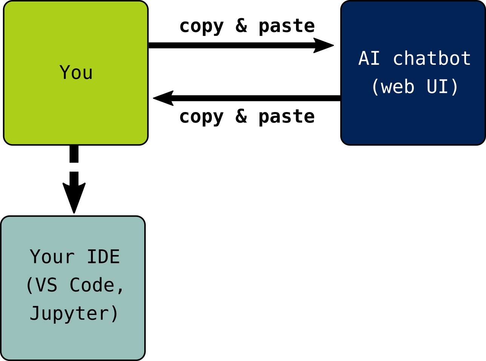
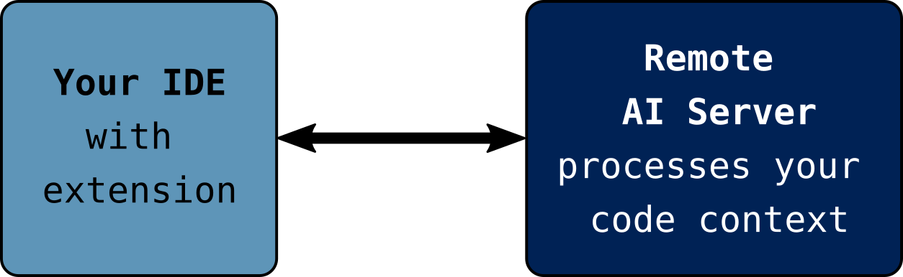
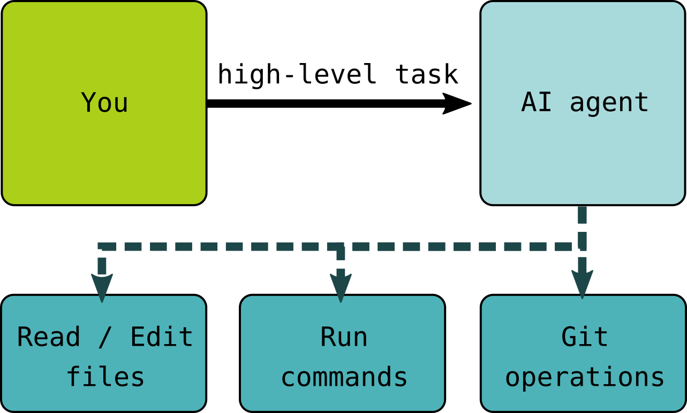

:::::::::::::::::::::::::::::::::::::: questions 

- What does the current landscape of genAI tools for coding look like?
- What AI tools are researchers and programming novices typically using?

::::::::::::::::::::::::::::::::::::::::::::::::

::::::::::::::::::::::::::::::::::::: objectives

- Summarise the different modes of interaction that currently exist for AI-assisted coding.
- Identify which of these modes are most likely to be used by members of the target audience for our workshops.

::::::::::::::::::::::::::::::::::::::::::::::::

:::::::::::::::::::::::::::::::: callout

### Acknowledgement

Some of the content in this episode is adapted from [Code Refinery's _Responsible Use of Generative AI in Assisted Coding_](https://coderefinery.github.io/coding-with-ai/introduction/) ([licensed CC-BY 4.0](https://github.com/coderefinery/coding-with-ai/blob/main/LICENSE)).

::::::::::::::::::::::::::::::::::::::::

AI coding assistance comes in many forms. 
Here is an overview of the different ways that users interact with these tools.

## Dialogue with a chatbot

{
alt='In this scenario, you type or copy/paste prompts into a chatbot interface (usually a web UI) and copy/paste the code you get back as a response into an IDE or another environment where it can be executed.'
}

The most widely-used mode of interaction with genAI models is the chatbot.
Most users interact with a chatbot via an app or web interface.
Conversations generally consist of back-and-forth exchanges of relatively short messages.
Some chatbot tools have access to a compute environment and the ability to run tools, search the internet, etc, while others are more limited.

## IDE integrations

{
alt='In this scenario, you work with a GenAI model through an extension or integration to an IDE. The model has access to the project files and processes this information into its context.'
}

Another mode of interaction for those developing software is the use of a genAI model via an extension or features of an integrated development environment (IDE).
In this case, the model processes the files in the project you are working on in the IDE and includes that information in its context window. 
(Roughly speaking, the model's context window is its working memory of information relevant to the whatever response it will produce next.)
Through the IDE, the model can suggest auto-completion, e.g., of a function body based on the docstring that has been written, and provides a chat interface for prompts.
There are genAI extensions available for most IDEs, as well as some "AI first" IDEs that boast more extensive integration.

## Agentic Coding Tools

{
alt='In this scenario, you provide a high-level description of a task that you want an AI agent to perform. The agent is able to execute software on the system, read and edit files, perform version control operations, etc.'
}

The final mode of interaction discussed here is the operation of _coding agents_.
These are applications that allow the model to directly use tools, executing commands on the system and processing feedback from those commands (e.g., reading error messages and the contents of output files).
The user provides a description of the task they want to achieve to the agent, which processes those instructions and acts on the user's behalf.
The agent may read and write files, including new programs, run commands on the system, process feedback, potentially run new commands based on the results, and so on until it gets stuck, is interrupted, or determines that the task has been completed.

This is the most powerful mode of interaction and the mode with the highest risk, since the model can act quickly in ways that affect the system it is running on.

:::::::::::::::::::::::::::::::: callout

In reality, AI coding tools exist on a spectrum with many hybrids, and the boundaries are blurry between these modes of interaction.
For example, some browser-based chat interfaces are now similar to locally-run agent tools, running in a cloud-hosted environment where they have the ability to install and run tools.
Review Code Refinery's resource, [_The Full Spectrum of AI Coding Tools_](https://coderefinery.github.io/coding-with-ai/appendix-spectrum/) for an extended taxonomy.

Furthermore, the rate of change in AI (coding) tools is extremely fast, and access to the most advanced tooling is unequally distributed.
We try to discuss the usage of these tools in general during this training, but the most appropriate actions to take in your workshops may differ depending on your local context.

::::::::::::::::::::::::::::::::::::::::

## What Are Learners Using?
The technological landscape is evolving quickly, with new tools and models appearing very frequently.
In this context, it can be difficult to access hard data that could provide insights into what people are using and how.

In survey results published in April 2026, O'Brien and colleagues reported that the vast majority of scientists who reported using genAI to assist programming in their research were using a chatbot (mostly ChatGPT) as their primary tool [(O'Brien et al 2026)](../learners/reference.md#OBrien2026).
Experience reports shared by Carpentries Instructors and other educators also suggest that chatbots are the primary mode of engagement for learners.

While some learners may be trying out more specialised tools intended for AI-assisted software development (e.g., Cursor and Claude Code), the current focus of this bonus module will be on learners' use of chatbots in workshops.

::::::::::::::::::::::::::::::::::::: keypoints 

- People are using chatbots, IDE integrations, and coding agents to assist with software development and data analysis.
- Data is scarce and the landscape is constantly shifting, but at the moment it seems that chatbots are the most common mode of engagement with genAI for our target learners.

::::::::::::::::::::::::::::::::::::::::::::::::

